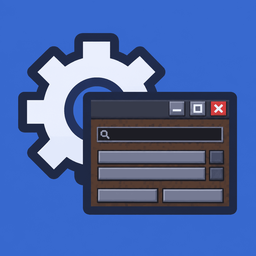

# Neo Configuration Screen Port

[](LICENSING.md)
[](https://github.com/neoforged/NeoForge)
[](#)
[](#)

Brings the in-game configuration screen that NeoForge ships with to other mod loaders, so a mod's
settings look and behave the same everywhere it runs: the same file overview, the same sections,
the same widgets, tooltips, undo and reset.

The screen is a port of NeoForge's implementation, so it keeps NeoForge's package names and entry
points. Mods that already register a NeoForge configuration screen work here unchanged; mods written
for other loaders only need to register the screen once.

This project is not affiliated with, endorsed by, or supported by NeoForged.

## What you get

- One screen per config file, with a breadcrumb title so you always know where you are.
- Sections become sub-screens, in the order your config defines them.
- Widgets chosen from the value type: switches for booleans, sliders for ranged numbers, text boxes
  for free numbers and strings, cycle buttons for enums, a dedicated screen for lists.
- Tooltips built from your config comments, with translated tooltips taking priority.
- Unlimited undo, reset-to-default, and a restart hint when a value only takes effect later.
- Elements that cannot be edited right now are disabled with the reason shown, instead of failing
  silently.
- Mods without translations still get readable labels instead of raw translation keys.

## Using it from your mod

Register the screen once during client setup:

```java
ConfigScreenRegistration.register(MOD_ID);
```

Your configs then appear behind the config button in the mod list. Pass an `IConfigScreenFactory` to
supply your own screen, or subclass `ConfigurationScreen` to change behaviour while keeping the
layout.

Translation keys follow NeoForge's scheme: `<mod id>.configuration.<path>` for values,
`<mod id>.configuration.title` for the title of a config file and
`<mod id>.configuration.section.<file>` for the entry in the file overview. Anything you leave out
falls back to the comment written in the config spec.

## 中文

把 NeoForge 自带的游戏内配置界面带到了其它模组加载器上：同一个文件总览、同样的分组、同样的控件、
提示框以及撤销与重置，让模组的设置在哪里打开都是同一个样子。

界面是对 NeoForge 实现的移植，因此保留了它的包名与入口。已经为 NeoForge 写过配置屏幕的模组可以
原样使用；其它加载器的模组只需注册一次。

本项目与 NeoForged 无关联，也未获其认可或支持。

**能做什么**

- 每个配置文件一个界面，标题是面包屑，随时知道自己在哪一层。
- 分组自动成为子界面，顺序与配置里声明的一致。
- 按值类型选择控件：布尔是开关，带范围的数字是滑块，普通数字与文本是输入框，枚举是循环按钮，
  列表有专门界面。
- 提示框取自配置注释，有翻译时优先使用翻译。
- 无限撤销、恢复默认，以及需要重启才生效时的提示。
- 当前不可编辑的条目会置灰并说明原因，而不是静默失败。
- 没写翻译的模组也不会看到裸的翻译键，而是可读的名字。

**接入方式**

客户端初始化时注册一次：

```java
ConfigScreenRegistration.register(MOD_ID);
```

配置随后会出现在模组列表的配置按钮后面。需要自定义时传入 `IConfigScreenFactory`，或在保留布局
的前提下继承 `ConfigurationScreen`。

翻译键沿用 NeoForge 的规则：值是 `<模组 id>.configuration.<路径>`，标题是
`<模组 id>.configuration.title`，文件总览里的一行是 `<模组 id>.configuration.section.<文件名>`。
缺失的部分回退到配置规格里写的注释。

## Thanks

- **The NeoForged team and contributors** — for NeoForge's configuration screen, which this project
  ports, and for the API shape it keeps.
- **Fuzss** — for Forge Config API Port, the config API that makes the same screen possible on
  Fabric.

## License

This project is distributed under the **Mozilla Public License 2.0**. File headers take precedence
over the project-wide license:

- Files ported from NeoForge keep `SPDX-License-Identifier: LGPL-2.1-only` and the NeoForged
  copyright notice. They are not relicensed.
- Files derived from Forge Config API Port keep `MPL-2.0` and the original copyright notice.
- Files written for this project are `MPL-2.0`, copyright Huziyang520.

`LICENSING.md` lists every adapted source and which package it came from. The full license texts are
bundled in the jar as `LICENSE` and `LICENSE-LGPL-2.1.md`.
