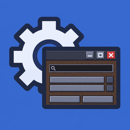

# Neo Configuration Screen Port

[](https://github.com/Huziyang520/NeoConfigurationScreenPort/blob/main/LICENSING.md)
[](https://github.com/neoforged/NeoForge)
[](https://github.com/neoforged/NeoForge)
[](https://neoforged.net/)

Brings the in-game configuration screen that NeoForge ships with to other mod loaders, so a mod's
settings look and behave the same everywhere it runs: the same file overview, the same sections,
the same widgets, tooltips, undo and reset.

The screen is a port of [NeoForge](https://github.com/neoforged/NeoForge)'s implementation, so it
keeps NeoForge's package names and entry points; on Fabric the config data comes from
[Forge Config API Port](https://github.com/Fuzss/forge-config-api-port). A screen written for NeoForge
keeps its code: the constructors take the loader's `ModContainer`, the section subclass and the filter
callback keep their signatures. Only the registration call is different, because Forge has no config
screen extension point of its own — this project supplies it as a one-liner.

This project is not affiliated with, endorsed by, or supported by NeoForged.

## 🎮 What you get

- 📄 One screen per config file, with a breadcrumb title so you always know where you are.
- 🗂️ Sections become sub-screens, in the order your config defines them.
- 🎚️ Widgets chosen from the value type: switches for booleans, sliders for ranged numbers, text
  boxes for free numbers and strings, cycle buttons for enums (translated when the enum asks for it),
  a dedicated screen for lists.
- ➕ Lists are edited on their own screen: every entry can be added, moved up or down and deleted, with
  undo, reset, and the type of a new entry taken from the list's default value.
- 💬 Tooltips built from your config comments, with translated tooltips taking priority.
- ↩️ Unlimited undo, reset-to-default, and a restart hint when a value only takes effect later.
- 🔒 Elements that cannot be edited right now are disabled with the reason shown, instead of
  failing silently.
- 🌐 Mods without translations still get readable labels instead of raw translation keys, and the
  screen's own labels ship in the same languages NeoForge ships them in.

## 🚀 Using it from your mod

Register the screen once during client setup:

```java
ConfigScreenRegistration.register(MOD_ID);
```

Your configs then appear behind the config button in the mod list. Pass an `IConfigScreenFactory` to
supply your own screen, or subclass `ConfigurationScreen` to change behaviour while keeping the
layout. The call belongs on the client: this game version has no `@Mod(dist = ...)`, so check
`FMLEnvironment.dist == Dist.CLIENT` or keep it in a client only class.

A list accepts new entries of the element type its default value uses. Register a template when that is
not enough: `ListElements.register(MOD_ID, "path.to.key", () -> "", 0, 64)`.

Translation keys follow NeoForge's scheme: `<mod id>.configuration.<path>` for values,
`<mod id>.configuration.title` for the title of a config file and
`<mod id>.configuration.section.<file>` for the entry in the file overview. Anything you leave out
falls back to the comment written in the config spec.

## 🙏 Thanks

- **[The NeoForged team and contributors](https://github.com/neoforged/NeoForge)** — for NeoForge's
  configuration screen, which this project ports, and for the API shape it keeps.
- **[Fuzss](https://github.com/Fuzss)** — for
  [Forge Config API Port](https://github.com/Fuzss/forge-config-api-port), the config API that makes the
  same screen possible on Fabric.

## ⚖️ License

This project is distributed under the **Mozilla Public License 2.0**. File headers take precedence
over the project-wide license:

- Files ported from NeoForge keep `SPDX-License-Identifier: LGPL-2.1-only` and the NeoForged
  copyright notice. They are not relicensed.
- Files derived from Forge Config API Port keep `MPL-2.0` and the original copyright notice.
- Files written for this project are `MPL-2.0`, copyright Huziyang520.

`LICENSING.md` lists every adapted source and which package it came from. The full license texts are
bundled in the jar as `LICENSE` and `LICENSE-LGPL-2.1.md`.

---

# Neo Configuration Screen Port · 中文

把 NeoForge 自带的游戏内配置界面带到了其它模组加载器上：同一个文件总览、同样的分组、同样的控件、
提示框以及撤销与重置，让模组的设置在哪里打开都是同一个样子。

界面是对 [NeoForge](https://github.com/neoforged/NeoForge) 实现的移植，因此保留了它的包名与入口；
Fabric 端的配置数据来自 [Forge Config API Port](https://github.com/Fuzss/forge-config-api-port)。
按 NeoForge 写的界面代码在这里不用改：构造器收加载器的 `ModContainer`，子屏幕与过滤器回调的签名一致；
只有注册那一步不同——Forge 没有自己的配置屏幕扩展点，本项目用一行补上。

本项目与 NeoForged 无关联，也未获其认可或支持。

## 🎮 能做什么

- 📄 每个配置文件一个界面，标题是面包屑，随时知道自己在哪一层。
- 🗂️ 分组自动成为子界面，顺序与配置里声明的一致。
- 🎚️ 按值类型选择控件：布尔是开关，带范围的数字是滑块，普通数字与文本是输入框，枚举是循环按钮
  （实现了翻译的枚举会显示名字），列表有专门界面。
- ➕ 列表在自己的界面里编辑：每条都能新增、上移、下移、删除，带撤销与恢复默认；新条目的初值取自
  该列表的默认值。
- 💬 提示框取自配置注释，有翻译时优先使用翻译。
- ↩️ 无限撤销、恢复默认，以及需要重启才生效时的提示。
- 🔒 当前不可编辑的条目会置灰并说明原因，而不是静默失败。
- 🌐 没写翻译的模组也不会看到裸的翻译键，而是可读的名字；界面自身的文案与 NeoForge 支持的语种一致。

## 🚀 接入方式

客户端初始化时注册一次：

```java
ConfigScreenRegistration.register(MOD_ID);
```

配置随后会出现在模组列表的配置按钮后面。需要自定义时传入 `IConfigScreenFactory`，或在保留布局
的前提下继承 `ConfigurationScreen`。这行调用属于客户端：本游戏版本没有 `@Mod(dist = ...)`，请用
`FMLEnvironment.dist == Dist.CLIENT` 判断，或放进只在客户端加载的类里。

列表的新条目沿用默认值的元素类型；不够用时再登记模板：
`ListElements.register(MOD_ID, "path.to.key", () -> "", 0, 64)`。

翻译键沿用 NeoForge 的规则：值是 `<模组 id>.configuration.<路径>`，标题是
`<模组 id>.configuration.title`，文件总览里的一行是 `<模组 id>.configuration.section.<文件名>`。
缺失的部分回退到配置规格里写的注释。

## 🙏 致谢

- **[NeoForged 团队与各位贡献者](https://github.com/neoforged/NeoForge)** —— 本模组移植的配置界面
  来自 NeoForge，API 形状也沿用自它。
- **[Fuzss](https://github.com/Fuzss)** ——
  [Forge Config API Port](https://github.com/Fuzss/forge-config-api-port) 提供了配置 API，让同一套界面在
  Fabric 上成为可能。

## ⚖️ 许可证

本项目整体以 **Mozilla Public License 2.0** 分发，文件头的声明优先于整体许可：

- 从 NeoForge 移植的文件保留 `SPDX-License-Identifier: LGPL-2.1-only` 与 NeoForged 版权行，不改标。
- 从 Forge Config API Port 派生的文件保留 `MPL-2.0` 与原版权行。
- 为本项目新写的文件为 `MPL-2.0`，版权 Huziyang520。

`LICENSING.md` 逐文件列出了来源与所属包；完整许可证全文随 jar 以 `LICENSE` 与
`LICENSE-LGPL-2.1.md` 分发。